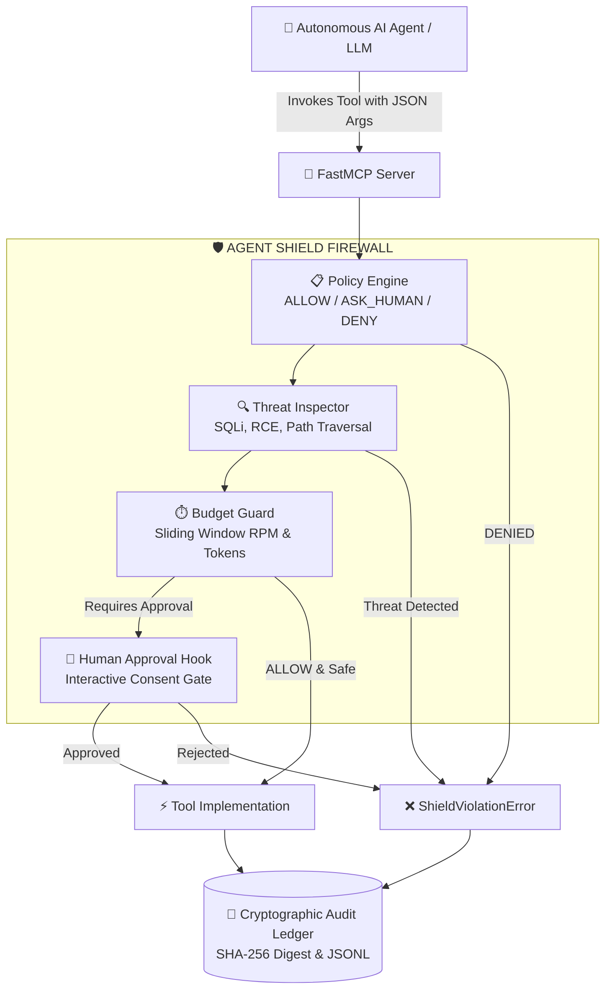

<div align="center">

# 🛡️ Agent Shield MCP
### Zero-Trust Security Firewall, Sandboxing & Human-in-the-Loop Governance for FastMCP Tools

[](https://www.python.org/)
[](https://github.com/jlowin/fastmcp)
[](https://github.com/frankitoromas-tech/agent-shield-mcp/actions)
[](https://opensource.org/licenses/MIT)
[](https://github.com/frankitoromas-tech)

<p align="center">
  <b>Declarative defense-in-depth security layer designed to prevent autonomous AI agents from executing destructive tool calls, path traversals, SQL injections, or unconstrained token loops.</b>
</p>

</div>

---

## 🎯 The Problem

Large Language Models (LLMs) connected to tool-calling protocols like **Model Context Protocol (MCP)** possess latent agency to read files, execute shell commands, query internal production databases, and mutate infrastructure. 

Without an enforcement boundary between the model's reasoning loop and tool execution:
1. **Indirect Prompt Injections** can hijack model instructions to run destructive commands (`rm -rf`, `DROP TABLE`).
2. **Path Traversals** can exfiltrate sensitive files (`../../etc/shadow`, `.env`).
3. **Runaway Loops** can exhaust rate limits and rack up high API bills within minutes.
4. **Lack of Auditing** makes incident response and forensic analysis impossible after an agentic breach.

**Agent Shield MCP** solves this by acting as a transparent, high-performance firewall intercepting every tool invocation before code execution.

---

## 🏛️ Architecture



---

## ✨ Core Features

| Feature | Description |
| :--- | :--- |
| **Zero-Trust Policy Engine** | Declarative evaluation of tools with three explicit states: `ALLOW`, `ASK_HUMAN`, and `DENY`. |
| **Threat Regex Guard** | Dynamic inspection of parameter values for known exploit signatures (Path Traversal `../`, SQL Injection, Command Injection pipes/semicolons). |
| **Sliding-Window Rate Limiter** | Thread-safe per-tool invocation throttling (requests per minute) to stop recursive runaway loops. |
| **Token Budget Accrual** | Cumulative tracking of estimated tokens consumed to prevent budget overruns. |
| **Human-in-the-Loop (HITL)** | Intercepts high-risk operations and awaits operator confirmation via callback, Slack hook, or approval portal. |
| **Cryptographic Audit Ledger** | Immutable JSONL ledger calculating deterministic SHA-256 signatures of call arguments for forensic compliance. |

---

## 📦 Installation

```bash
git clone https://github.com/frankitoromas-tech/agent-shield-mcp.git
cd agent-shield-mcp
pip install -e .
```

---

## 🚀 Quickstart Guide

### 1. Protect FastMCP Tools

```python
from agent_shield import AgentShield, Decision, RiskLevel

# Initialize Shield with default zero-trust posture
shield = AgentShield(
    default_decision=Decision.ASK_HUMAN,
    audit_file="logs/mcp_audit.jsonl"
)

# Declarative policy definition
shield.allow("get_weather", risk_level=RiskLevel.LOW)
shield.ask("update_order_status", risk_level=RiskLevel.HIGH)
shield.deny("execute_shell", risk_level=RiskLevel.CRITICAL)

# Wrap any FastMCP or Python tool
@shield.protect(name="update_order_status")
def update_order_status(order_id: int, new_status: str) -> dict:
    return {"order_id": order_id, "status": new_status}
```

### 2. Human-in-the-Loop Approval Callback

```python
def my_custom_approver(tool_name: str, arguments: dict, reason: str) -> bool:
    print(f"Agent requests permission for '{tool_name}' with {arguments}")
    # Return True to permit execution, False to block
    return True

shield.set_human_approval_callback(my_custom_approver)
```

---

## 🧪 Testing & Verification

Agent Shield comes with a rigorous PyTest test suite testing multi-threaded budget limits, threat patterns, and async tool wrappers:

```bash
pytest -v
```

---

## 👨‍💻 Author & Attribution

- **Developer:** Frank Emiliano Vargas Huamán ([@frankitoromas-tech](https://github.com/frankitoromas-tech))
- **Signature / Brand:** `Frankosyni (Φρανκοσύνη/Francus.)` 🔥
- **Specialty:** Software & Agentic AI Developer | Backend Java Enterprise

---

## 📄 License

This project is licensed under the [MIT License](LICENSE).
